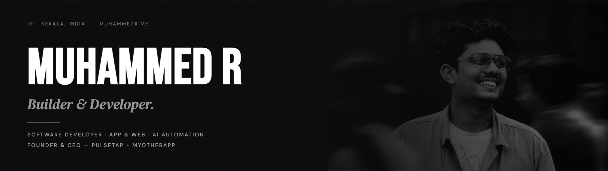
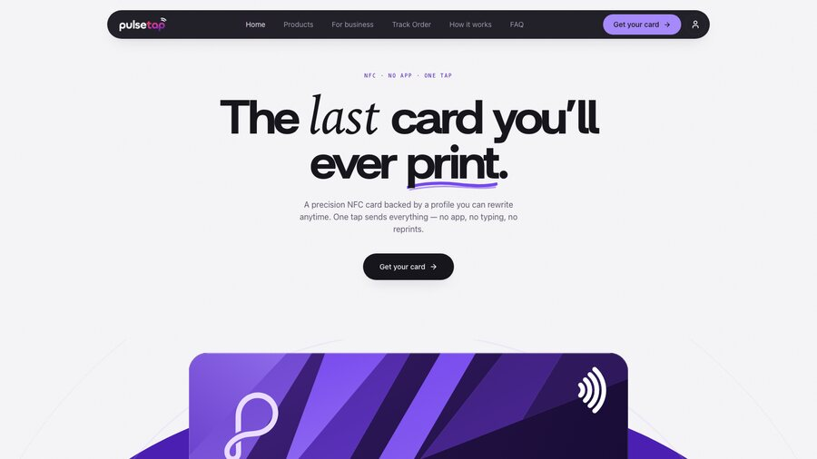
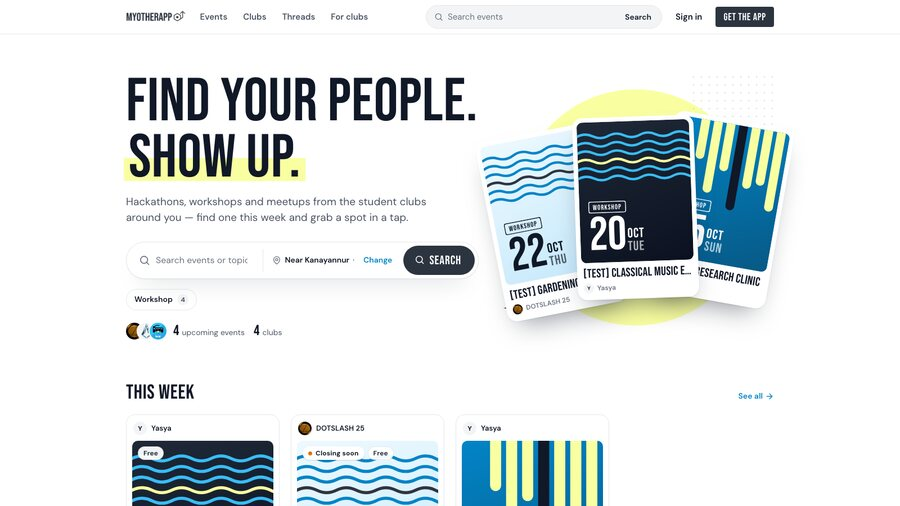

  

  

  
  
  
  

---

## 🚀 What I'm building

<table>
<tr>
<td width="50%" valign="top">

### PulseTap

A precision **NFC business card** backed by a profile you can rewrite anytime. One tap sends everything — no app, no typing, no reprints.

Change jobs and keep the card: point it at a new profile in two taps, and the one already in someone's wallet still works.

**Founder & CEO** · Feb 2025 — present
<a href="https://pulsetap.in">pulsetap.in&nbsp;↗</a> · <a href="https://www.muhammedr.me/pulsetap/">Case study</a>

</td>
<td width="50%" valign="top">

### MyOtherApp

**Events and clubs near you.** Hackathons, workshops and meetups from the student clubs that actually run them — find one this week and grab a spot in a tap.

Clubs get a home rather than a broadcast, so the next thing they organise reaches the people who came to the last one.

**Founder & CEO** · Oct 2026 — present
<a href="https://myotherapp.in">myotherapp.in&nbsp;↗</a> · <a href="https://www.muhammedr.me/myotherapp/">Case study</a>

</td>
</tr>
</table>

---

## 🛠 Stack

  
  
  
  
  
  
  
  
  
  
  

---

## 📊 GitHub

  
  

---

## 🤝 Connect

  
  
  
  
  

 

  <i>Based in Kerala, India · Always building something.</i>

